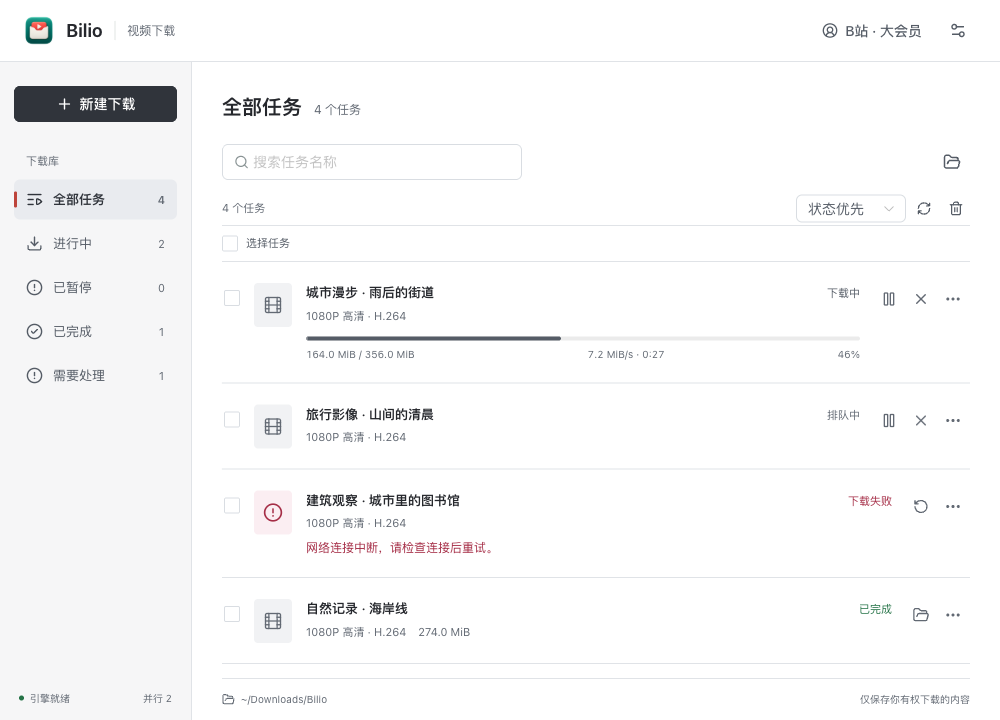

# Bilio

面向 macOS 的 B站视频下载工具。使用 Tauri 2、Vue 3 和 yt-dlp，将账号登录、画质选择、批量下载和任务恢复放在一个桌面界面中。

**当前源码版本：0.4.0，本机候选版。** 已在一台 Apple Silicon Mac 上验证核心流程，尚未完成 Apple Developer ID 签名、公证和跨环境验收，不等同于成熟 1.0 或已公开发布的安装包。



上图使用真实界面组件和合成任务展示布局，不是真实账号或下载验收截图。

## 主要功能

- **官方扫码登录**：独立窗口打开 B站官方登录页，默认仅本次运行；用户确认后可保存到 macOS 系统钥匙串，启动时重新验证。
- **画质与编码**：单集默认优先 1080P/H.264，可选择账号对该视频实际可用的档位；有信息时显示时长、尺寸和预计大小。
- **番剧与批量任务**：分集搜索、范围选择、失败分集重试、批次折叠，并发 1–3 个任务，默认 2 个。
- **下载管理**：分类、搜索、详情、多选操作、实时进度、速度、剩余时间和 Finder 定位。
- **暂停和恢复**：下载阶段可暂停、继续或取消；合并阶段不提供暂停。重开保留暂停/中断状态，由用户手动继续，不自动重放。
- **文件保护**：独立临时目录、空间与写入检查；同名默认保留两份，也可校验相同后复用，或额外确认后替换。清理记录不会删除最终视频。
- **错误处理**：引擎重启、任务刷新、更换失败任务目录、临时文件确认清理，以及脱敏诊断预览/导出。
- **手动检查公开版本**：只查询版本信息，不自动下载或安装更新。

独立登录是主入口，不要求读取 Chrome 等外部浏览器的数据。浏览器 Cookies 导入保留为高级备用方式，可能需要单独的系统授权。

## 可用范围与限制

| 项目 | 当前状态 |
| --- | --- |
| 系统 | 已验证一台 macOS Apple Silicon；Intel Mac、Windows、Linux 和手机端未验证 |
| 会员能力 | 取决于账号对具体视频的访问权限；登录会员不保证所有来源均有 4K |
| 内容类型 | 本轮真实下载验收限定在授权番剧；普通视频、分 P、合集和短链未完成本轮真实验收 |
| 下载目录 | 暂支持可安全硬链接发布的本机文件系统；部分外置盘格式不支持 |
| 播放兼容性 | 实测 4K 为 AV1/AAC，1080P 为 H.264/AAC；不保证所有播放器支持所有编码 |
| 登录异常 | 真实账号过期、钥匙串锁定/拒绝、换账号等仍缺完整原生实测 |
| 更新 | GitHub 匿名 API 限流或网络异常时可能检查失败，不影响已有版本下载 |
| 分发 | 本机 ad-hoc 签名，未公证；正式签名下的跨升级钥匙串行为未验证 |

已实测官方扫码、可选保持登录与冷启动恢复、仅本次使用、退出后不自动登录、整季元数据解析、完整 4K/1080P 下载、暂停重开续传及三轮受控异常恢复。两个新增输出均通过全程音视频解码。详细边界见 [0.4.0 验收摘要](docs/RELEASE_CANDIDATE_0.4.0.md)。

这些结果支持在已验证范围内日常使用，不代表所有视频、浏览器、文件系统或异常场景都已覆盖。

## 安装与使用

0.4.0 本轮同步的是源码和文档，**不包含新安装包发布**。[Releases](https://github.com/albertma-code/Bilio/releases) 中如有历史产物，应按其实际版本判断，不视为 0.4.0。

自行构建后，将 Bilio.app 放入“应用程序”，只保留一个日常入口。备份应用建议压缩归档，避免系统应用列表出现多个同名图标。当前包未公证，请自行核验来源，不通过关闭系统安全保护来安装。

首次使用可在“设置 → B站账号”扫码登录，再粘贴链接、解析、确认画质与目录后加入下载列表。“在此 Mac 上保持登录”默认关闭，开启需亲自确认保存到系统钥匙串。

## 本地开发

需要 macOS、Rust stable、Node.js LTS 和 Python 3.11。构建后的应用自带 Python 下载引擎和 ffmpeg，使用者无需单独安装 Python。

```bash
# Python 与 Node.js 依赖
python3.11 -m venv .venv-stable
.venv-stable/bin/python -m pip install -r requirements.txt
npm ci

# 首次开发或修改 Python 后构建 sidecar
bash sidecar/build.sh

# 启动桌面开发模式
npm run tauri dev

# 构建应用、本机签名并生成校验后的 DMG
npm run release:mac
```

产物位于 `src-tauri/target/release/bundle/`。本机构建/签名通过不等于 Apple 公证或公开分发验收通过。

短回归和界面检查说明见 [贡献指南](CONTRIBUTING.md)。仓库提供 macOS CI 流程，是否通过以实际 Actions 结果为准。

## 架构与数据

```text
Vue 3 / TypeScript / Naive UI
          | Tauri commands / events
Tauri 2 / Rust：窗口、权限、钥匙串与引擎桥接
          | JSONL over stdio
Python sidecar：yt-dlp、任务队列、SQLite、隔离下载进程 / ffmpeg
```

登录凭据不交给 Vue 前端，不保存到任务数据库或普通配置文件。任务库位于系统应用数据目录，保存来源、任务设置、状态和恢复信息，因此仍应作为个人数据保护。下载目录偏好与非凭据 UI 设置可保存于 localStorage。

0.4.0 使用数据库 schema 2，升级前保留旧库备份。回退旧版不能只替换应用，需要分别保留当前数据库、旧库备份和视频，按对应版本恢复，不要直接覆盖历史。

## 安全与使用边界

Bilio 仅用于保存用户本人有权保存的内容，不支持破解、DRM 解密或绕过付费验证。用户应自行确认下载、使用和传播内容所需的权限。

不要提交 Cookie、令牌、登录数据、私有链接、真实任务数据库、下载媒体或含个人信息的日志。诊断仅在用户主动操作时预览、复制或导出，不自动上传。更多说明见 [安全与隐私](SECURITY.md)。

## 许可证

Bilio 自有源码采用 [MIT](LICENSE)；该许可不替代第三方依赖的许可。

下载由 [yt-dlp](https://github.com/yt-dlp/yt-dlp) 提供。实际捆绑 ffmpeg 标识为 GPL v2 或以后，不能将整个安装包笼统称为 MIT。公开再分发前仍需完成精确依赖许可、完整文本及对应源码义务核对，见 [第三方组件说明](docs/THIRD_PARTY_NOTICES.md)。
